<div align="center">

# 🎬 Cinematic 3D Web

### A Claude skill for building scroll-driven 3D scenes that match what you picture

**Describe the scene in your own words → Claude writes a shot-by-shot plan → you approve it → it builds it.**
No more rounds of *"no, not like that"*.

[](https://docs.claude.com/en/docs/agents-and-tools/agent-skills/overview)
[](#install)
[](LICENSE)


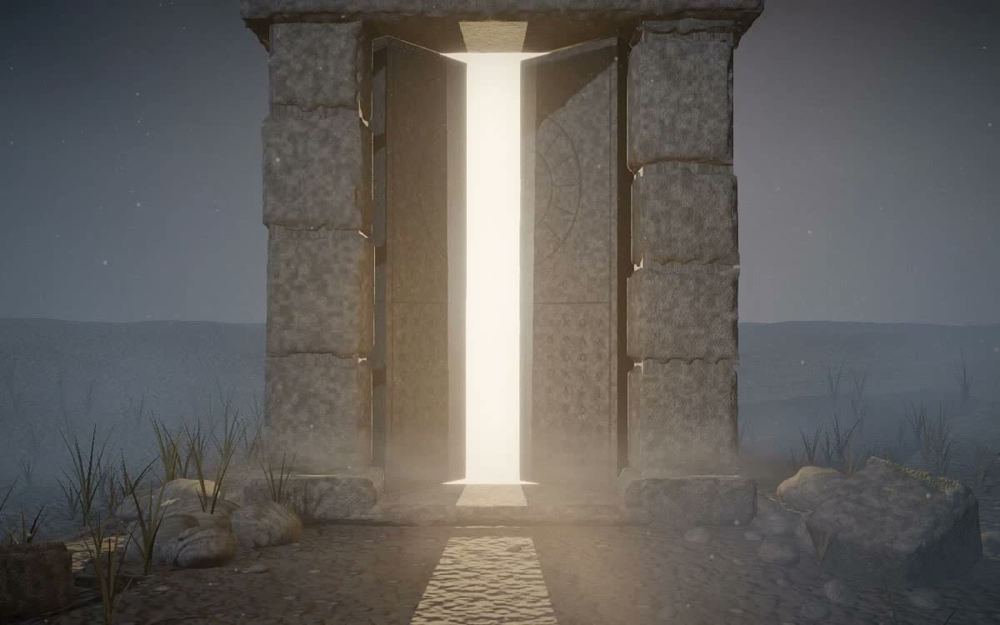

<sub>Built by Claude with this skill from one paragraph: <i>"a sneaker that assembles itself from floating pieces as you scroll, then the camera circles it… make it feel futuristic"</i>.</sub>

**[Install](#install)** · **[Quick start](#quick-start)** · **[How it works](#how-it-works)** · **[Full guide](docs/GUIDE.md)** · **[Examples](#examples)** · **[FAQ](#faq)**

</div>

---

## The problem it solves

Asking an AI for a 3D web animation usually goes like this:

1. You describe a feeling: *"make it epic"*, *"the logo gets sucked into a vortex"*, *"like an Apple product page"*.
2. It builds **something**, and it isn't what you pictured.
3. You correct it, again and again, until it finally "gets" your style.

The code was never the hard part. The hard part is that **feeling-words don't say where the
camera is, what moves, how fast, on which curve, lit how, or what the text does at each point of
the scroll**, so the AI guesses, and every wrong guess costs a whole rebuild.

This skill came out of exactly that experience: building
**[rayenchatti.vercel.app](https://rayenchatti.vercel.app)** took many rounds of steering before
the animations matched the idea. Everything learned in those rounds is packaged here, so you
don't have to teach it again.

## What it does

| | |
|---|---|
| 🎯 **Directs before it builds** | Turns your description into a short **scene spec**: a beat sheet of what's on screen at each stretch of scroll, with camera, motion, light, effects and text. You approve or correct it in one message, *before* any code exists. |
| 🗣️ **Speaks "motion"** | A vocabulary that translates ~25 vague words (*cinematic, epic, premium, dreamy, explodes, swallowed, comes alive, underwater…*) into concrete camera moves, easing, pacing, lighting and effects. |
| 🎨 **Any style, asked not assumed** | Realistic/natural, clean studio, neon cinematic, stylised, editorial, dreamy, each with concrete rules for light, materials and atmosphere. If you don't name a style, it **asks you** before planning. |
| 🧩 **Builds any scene, not a menu** | A technique library for camera rigs, shaders, particles, morphs, shatter, dissolve, vortex, glass, glow, atmosphere and text choreography. New ideas get built properly, not mapped to the nearest preset. |
| 🏗️ **On a proven foundation** | Pinned scroll stages, one timeline shared by the 3D and the text (they never drift), damped cameras, reduced-motion versions, WebGL that pauses off-screen. |
| 🎥 **Learns from references** | Give it a screen recording and it studies the motion frame by frame (`video-frames.mjs`). Show it a site or an image and it extracts the style. |
| ✅ **Checks its work** | Screenshots each beat at its scroll position and compares it with the approved plan. |
| 🎁 **Ships a full example** | A complete, production-tested 3D portfolio template you can use as-is or learn from. |

## See it

**From a one-paragraph prompt** — *"a sneaker that assembles itself from floating pieces, then the camera circles it while the features appear, futuristic"*:

| Floating parts | Assembly | Ignition (the key moment) | Orbit + features |
|:-:|:-:|:-:|:-:|
| 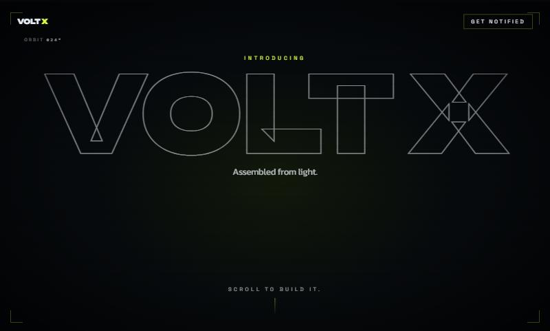 | 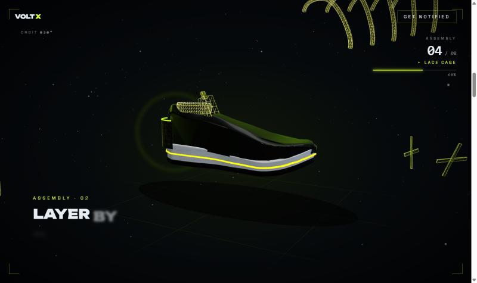 | 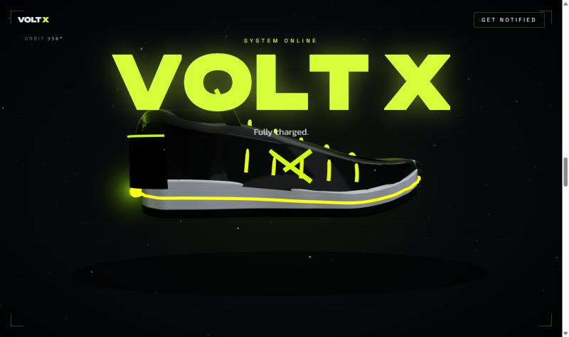 | 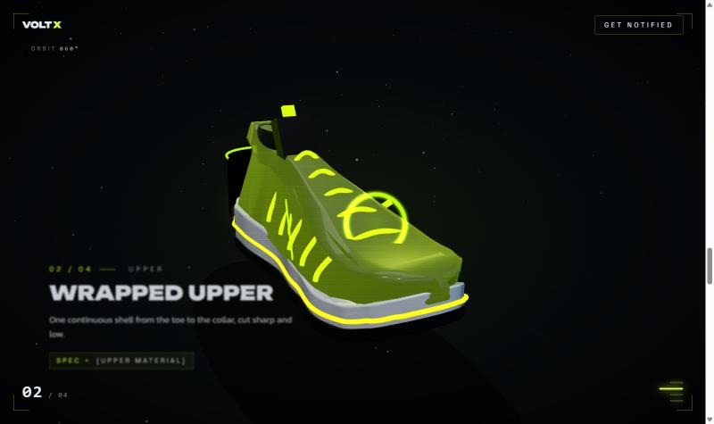 |

**Realistic style:** an ancient stone door in fog, grinding open as you scroll. Chipped stone, volumetric fog with light shafts through the doors, real shadows, dust, terrain and swaying grass, all generated in code with no models or downloaded textures ([example](skills/cinematic-3d-web/examples/ruin-door)):

| Closed, in the fog | Doors grinding open | The threshold |
|:-:|:-:|:-:|
| 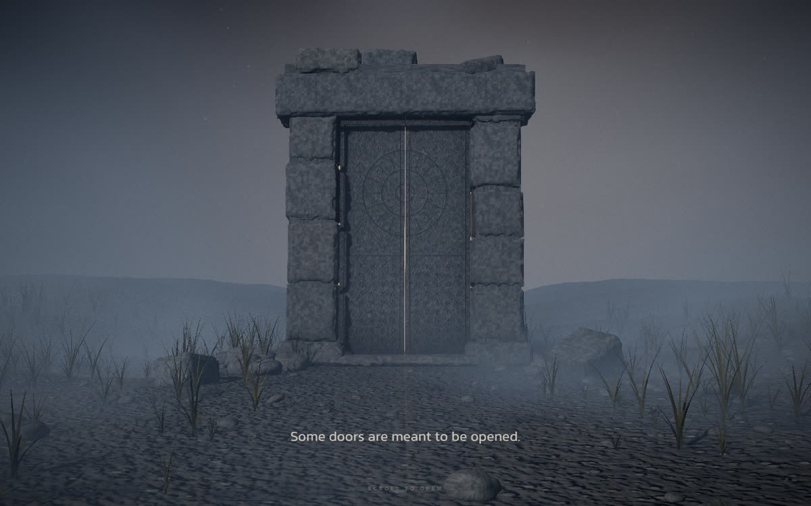 | 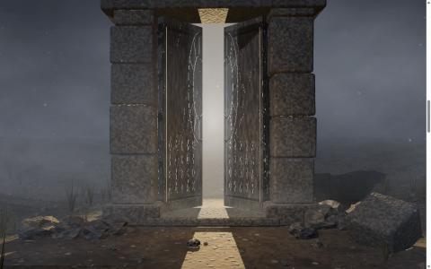 | 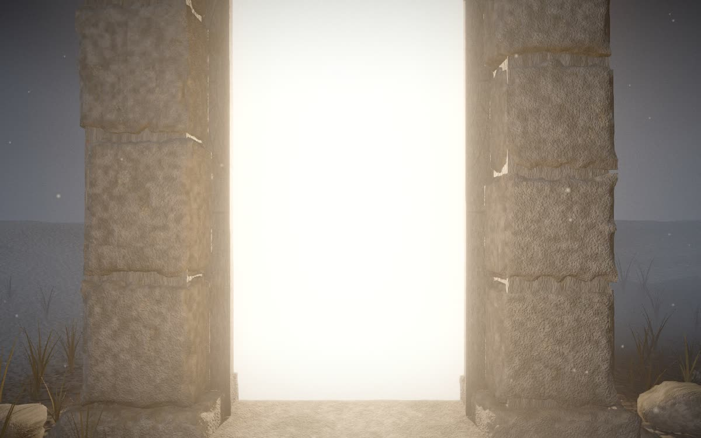 |

**The bundled portfolio template** (neon cinematic style, placeholder content, any accent colour):

| Hero | About: laptop opens on scroll | Skills: orbits around a core | Achievements: black-hole tunnel |
|:-:|:-:|:-:|:-:|
| 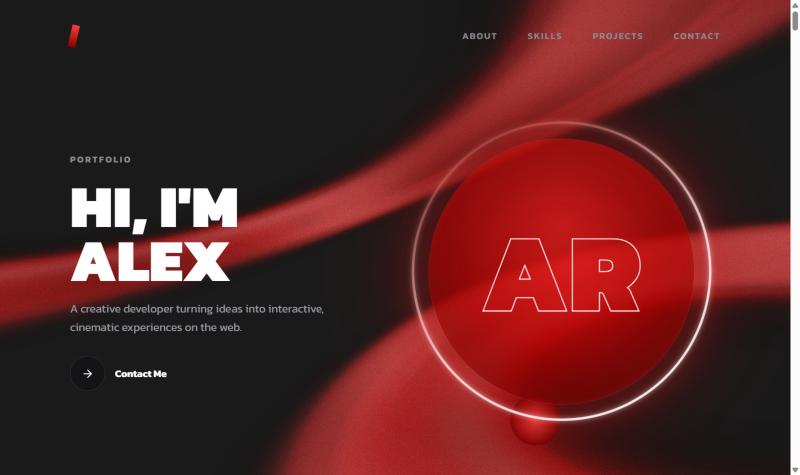 | 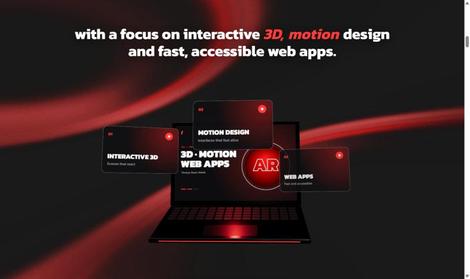 | 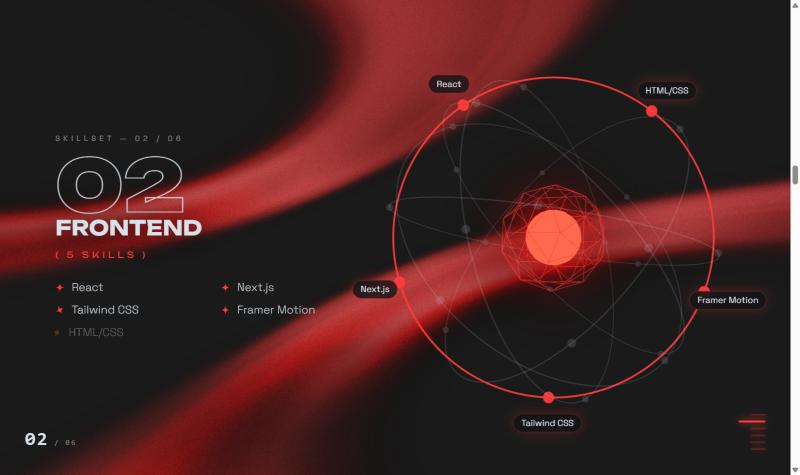 | 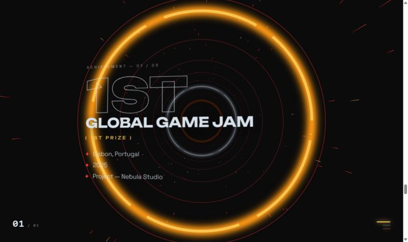 |

## Install

### Claude Code: as a plugin (recommended)

```
/plugin marketplace add rayenchatti/cinematic-3d-web
/plugin install cinematic-3d-web@cinematic-3d-web
```

### Claude Code: manually

```bash
git clone https://github.com/rayenchatti/cinematic-3d-web.git
cp -r cinematic-3d-web/skills/cinematic-3d-web ~/.claude/skills/
```

Windows (PowerShell):

```powershell
git clone https://github.com/rayenchatti/cinematic-3d-web.git
Copy-Item -Recurse cinematic-3d-web\skills\cinematic-3d-web $HOME\.claude\skills\
```

### Claude.ai / Claude desktop

Download the repo, zip the `skills/cinematic-3d-web` folder, and upload it under
**Settings → Capabilities → Skills**.

**Requirements for the generated sites:** Node.js 20.9+. Optional: `ffmpeg` (for reference videos).

## Quick start

Just describe what you want. The skill triggers on its own for 3D / scroll / animated-site requests.

> Make me a landing page for my coffee brand. When you scroll, the bean explodes and becomes a cup. Premium feel.

Claude replies with a plan like this (shortened):

| Scroll | On screen | Camera | Motion & change | Light / FX | Text |
|---|---|---|---|---|---|
| 0–15% | Bean centre frame, huge faded "ORIGIN" behind | Long lens, slow push-in | Bean turns 60°, scrubbed | Amber rim light brightens | Backdrop title fades |
| 15–30% | Bean cracks along its seam | Holds, handheld drift | Seam opens (anticipation) | Warm light leaks from the crack | Caption blurs in word by word |
| 30–45% | **Bursts into grains** | Pulls out | Particles fly out on curl noise | **Flash at 32%** | Caption lifts away |
| 45–70% | Grains swirl and condense into a cup | 40° orbit | Each grain eases to a cup-surface point | Cup material fades in | Second caption |

…plus the key moment, mobile and reduced-motion versions, the choices it made, and 2–3 questions
with defaults. Reply *"yes, go"* or correct it, then it builds.

More ways to ask:

> The hero of my music site should feel like sinking underwater at night.

> Here's a screen recording of a site I love (`ref.mp4`). I want this camera movement for my product page.

> On my existing Next.js site, make the intro paragraph shred into paper strips as you scroll.

> Build me a 3D portfolio. I'm Sam, a product designer in Berlin. Here's my CV. Make it green.

👉 **Read the [full guide](docs/GUIDE.md)** for how to get the best first result, how to give
feedback, and how to use the scripts.

## How it works

```
 your description / reference
            │
            ▼
 1. UNDERSTAND   what it's for · the feeling · references (video frames, sites, images)
            │
            ▼
 2. TRANSLATE    feeling-words → camera, motion, easing, light, FX, text, pacing   (scene-language.md)
            │
            ▼
 3. SPEC         shot-by-shot beat sheet + key moment + choices + 2–3 questions    (scene-spec.md)
            │      ◄── you approve or correct it here (cheap!)
            ▼
 4. BUILD        blockout → motion → look → polish, on the proven architecture     (architecture.md, techniques.md)
            │
            ▼
 5. VERIFY       screenshot each beat at its scroll position, compare with the spec
            │
            ▼
 6. REFINE       "feels cheap" → a specific change ("add a 0.3s hold before the burst")
```

## What's inside

```
skills/cinematic-3d-web/
├── SKILL.md                     the workflow Claude follows
├── references/
│   ├── scene-language.md        motion vocabulary + translations of vague words
│   ├── scene-spec.md            the beat-sheet format, with 3 worked examples
│   ├── techniques.md            how to build each kind of effect
│   ├── architecture.md          pinned-scroll scenes, shared timelines, rules from real bugs
│   ├── styles.md                the style families, and how it asks when you don't pick one
│   ├── house-style.md           the neon cinematic style as exact values + picking up a style from references
│   ├── effects.md               the portfolio's scenes, dissected
│   └── portfolio.md, content-guide.md, portrait-rig.md
├── scripts/
│   ├── create-site.mjs          new single-page site (landing/product page), optional first scene
│   ├── new-scene.mjs            scaffold a pinned scene: section + timeline + 3D canvas (or --no-canvas)
│   ├── video-frames.mjs         extract frames from a reference video (needs ffmpeg)
│   ├── create-portfolio.mjs     copy the full portfolio template
│   └── retheme.mjs              move the whole accent palette to any colour
├── examples/ruin-door/          a realistic scene (stone door, volumetric fog, light shafts) with notes
├── template/                    a complete 3D portfolio (Next.js) — the worked example
└── evals/                       test prompts used to measure the skill
```

## Tested

The skill was measured the way Anthropic's skill-creator recommends: the same prompts run with
and without the skill, graded against pass/fail checks, plus a visual review.

| Test prompt | With skill | Without |
|---|:-:|:-:|
| *"Movie-intro hero, dark and epic — don't build yet, tell me what you'd do"* | **7/7** | 5/7 |
| *"Sneaker assembles from floating pieces, camera circles it, futuristic — build it"* | **9/9** | 6/9 |
| *"Shred my intro paragraph into paper strips on scroll"* (existing site) | 7/7 | 7/7 |

The biggest differences weren't raw visuals; a strong model can look impressive on its own.
They were: a plan you can approve before anything is built, no invented product facts
(placeholders instead of made-up prices and specs), reduced-motion versions, and scenes that stop
rendering when off-screen. The test prompts are in [`skills/cinematic-3d-web/evals`](skills/cinematic-3d-web/evals).

## FAQ

**Will it get my scene right the first time?**
It moves the misunderstanding to the cheap moment. You correct a one-minute plan instead of a
finished build. After you approve the plan, the build usually matches it. Exact taste ("a
slightly softer glow") can still take a small tweak. A reference video or link closes the gap
fastest.

**Do I need to know three.js?**
No. You describe scenes and approve plans. If you do know it, the references are a solid
technical playbook too.

**Can I use it on my existing site?**
Yes, for React/Next.js projects. It changes only what the effect needs and tells you what it
moved. For non-React sites it can mount a scene as a React island or port the shader parts.

**Does it only make portfolios?**
No. Portfolios are one bundled example. Landing pages, product reveals, event sites, music
sites and any "scroll-through story" work the same way.

**What if I don't have a 3D model of my product?**
It builds a stylised stand-in from code (split into parts if the scene needs it), says so
clearly, and makes it easy to drop your real `.glb` model in later.

**Can it run on phones?**
Every scene gets a mobile framing pass and a reduced-motion version, and WebGL pauses when not
visible. Heavy effects (real bloom, glass) are used sparingly.

## Limitations

- Visual verification needs a browser tool in your Claude environment. Without one, Claude says
  so and gives you a checklist.
- Generated stand-in models are stylised, not product-accurate.
- The style rules are starting points; a reference image or video still gets you closest to a
  specific look.

## Contributing

Issues and PRs are welcome, especially:
- new worked examples in `references/scene-spec.md` (a spec next to the code that realised it);
- new translations in `references/scene-language.md` for words people actually use;
- new test prompts in `evals/` that the skill currently gets wrong.

## Credits

- Created by **[Rayen Chatti](https://github.com/rayenchatti)**, from building [rayenchatti.vercel.app](https://rayenchatti.vercel.app).
- `ColorBends` background and `Magnet` adapted from [React Bits](https://reactbits.dev) (MIT + Commons Clause).
- Floating typography pairing after [dungyov.com](https://dungyov.com).
- Icons: [Lucide](https://lucide.dev) and [Simple Icons](https://simpleicons.org) (CC0).

## License

[MIT](LICENSE). Portions adapted from React Bits remain under their original license.
