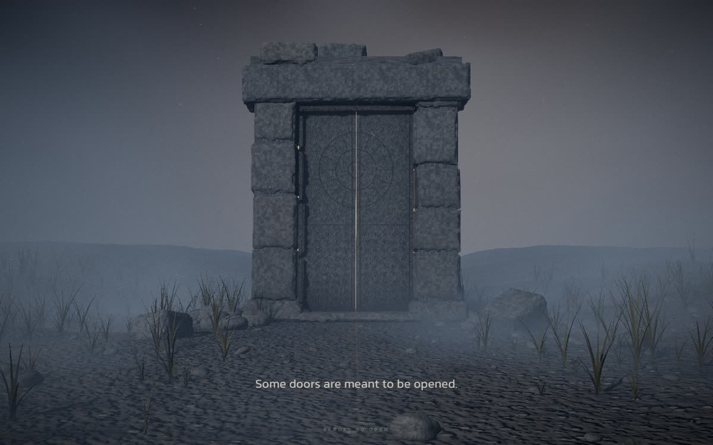
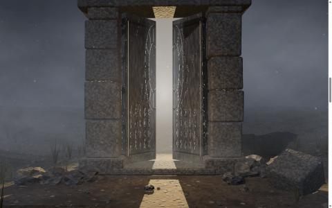
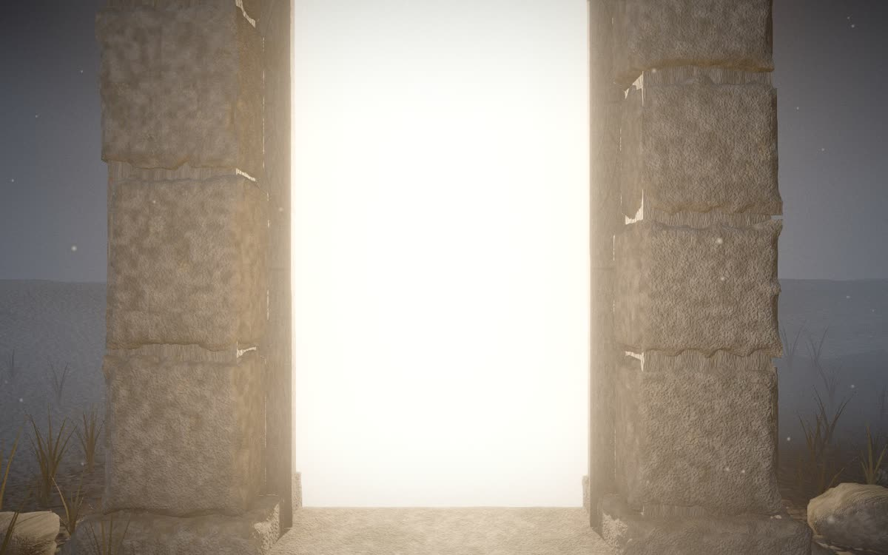

# Worked example: the ruin door (realistic / natural style)

An ancient stone door stands in a dusky, foggy ruin. As you scroll, carved stone doors grind open,
a shaft of warm sunlight falls through the doorway onto the ground, the camera passes through a
white-out, and comes out into the section on the other side — left empty for you to fill. Everything is generated in code — no
models or textures to download.

| Closed, in the fog | Doors grinding open | The threshold |
|:-:|:-:|:-:|
|  |  |  |

Built from one brief, then refined with two follow-ups ("make it realistic, an ancient ruin with fog
and dust" → "more fog on the sides, more realistic ground"). Read it alongside the *Realistic /
natural* section of `references/styles.md`.

## Files

| File | What it holds |
|---|---|
| `doorTimeline.ts` | Every beat as scroll fractions (intro, anticipation, open, threshold, white-out, arrival), the camera keyframes and the easing helpers. Shared by the scene and the section. |
| `DoorSection.tsx` | The pinned section: captions, white-out overlay, the bright section behind the door, reduced-motion version. |
| `DoorScene.tsx` | The 3D world: ruin, doors, light, fog, dust, ground detail, camera. |
| `ruinTextures.ts` | Procedural textures on 2D canvases: weathered stone (colour + bump, cracks, moss), carved door slabs, gravelly earth, fog puffs, dust dots. |
| `terrain.ts` | `heightAt(x, z)`: uneven ground with a flat worn path — used by the ground mesh and everything resting on it. |

## The techniques that make it look real

1. **Real light with real shadows.** A shadow-casting `spotLight` sits *behind* the closed doors
   and points at the viewer. Closed, only the seam lets light through — a thin bright line lands
   on the ground. As the doors open, the shadow-cast shaft widens across the threshold. A soft
   warm `pointLight` just in front adds the bounce. (`SunBeyond`)
2. **Weathered materials.** Stone colour + bump maps from fractal noise with pits, hairline cracks
   and moss in the low areas; door slabs have carved grooves (sunk in the bump, darkened in
   colour). Roughness 0.96, no emissive anywhere. (`ruinTextures.ts`)
3. **Imperfect construction.** Pillars are stacked `RoundedBox` blocks with small random shifts
   and rotations; a sagging lintel, a broken cap row, a fallen block, displaced-icosahedron
   rubble. Seeded randomness (`mulberry32`) keeps the layout identical on every load. (`Ruin`)
4. **Atmosphere that hides empty space.** `fogExp2` matching the background, low ground fog
   sprites that warm up near the beam, and big fog banks on both sides and behind the ruin.
   (`GroundFog`, `SideFog`)
5. **A ground that isn't flat.** A dense grid displaced by `heightAt`, rising into low mounds at
   the sides, flat along the worn path; 500 instanced pebbles and 400 instanced dry-grass clumps
   placed on the surface. (`Ground`, `Pebbles`, `Grass`)
6. **Weight.** While the doors move: camera rumble, grit falling from the lintel, dust puffs at
   the base. Slow, eased swing (~100° over a quarter of the scroll). (`rumble`, `Dust`, `DoorDust`)
7. **A volumetric beam** as an open cylinder with a custom shader: brightest at the doorway, soft
   view-dependent edges, faint streaks, additive. (`Beam`)
8. **A clean hand-off.** The bright world behind the door only fades in under the full white-out,
   so it never shows around the frame from the front. (`Beyond`)

## Reusing it

Copy the five files into `src/components/` of a project made with `scripts/create-site.mjs`
(needs `three`, `@react-three/fiber`, `@react-three/drei`, `framer-motion`), render
`<DoorSection />` in a page, and put your own section inside `Beyond` in `DoorSection.tsx`.
